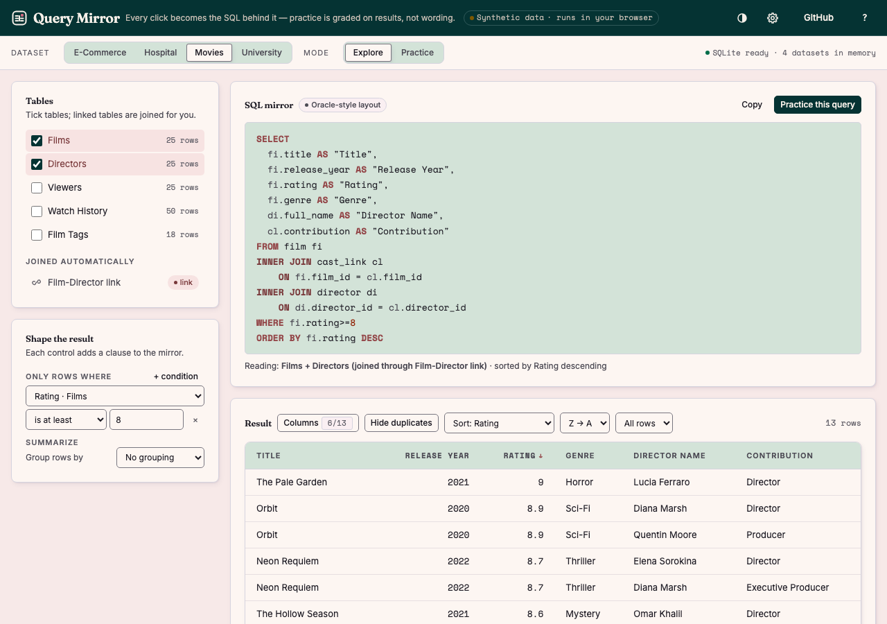
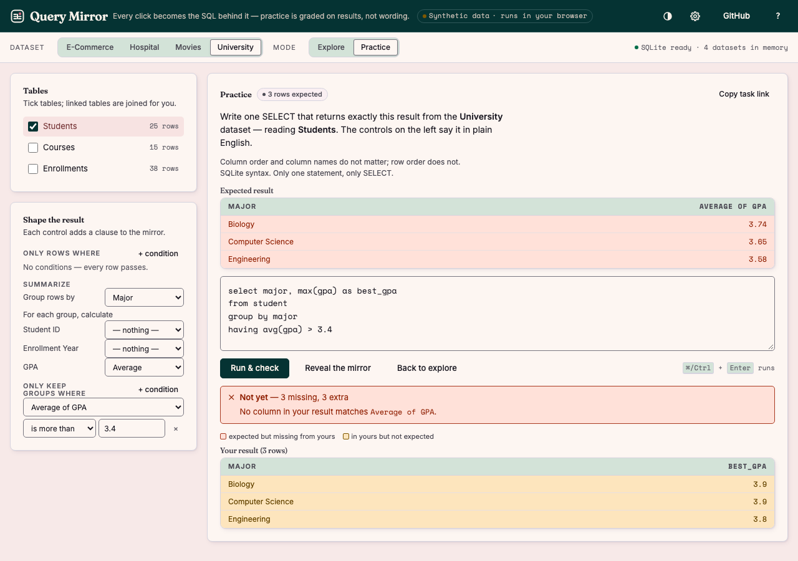
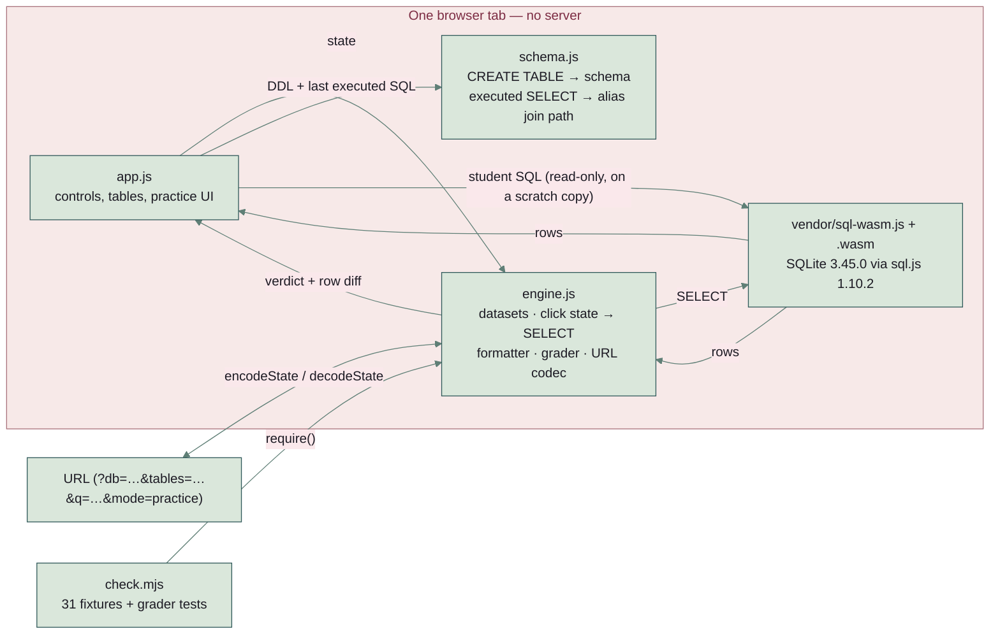

# Query Mirror

**Learn SQL by building a query with clicks, then write an equivalent query and check its results.**

For SQL learners and teachers: pick tables and filters, see the generated `SELECT`, then switch to Practice to find missing or extra rows in your answer.

**[Try the live demo](https://nickkklian.github.io/SQL-Viz-for-Edu/?db=movies&tables=film%2Cdirector)** · [Start a practice exercise](https://nickkklian.github.io/SQL-Viz-for-Edu/?db=hospital&exercise=names)

No account, install or server. Four synthetic teaching datasets run in SQLite inside your browser.

[](https://nickkklian.github.io/SQL-Viz-for-Edu/)

## Quick start

Open the live demo above, or clone and open `index.html` in a modern browser; the SQLite engine is included and works offline.

```sh
git clone https://github.com/NickkkLian/SQL-Viz-for-Edu.git
cd SQL-Viz-for-Edu
# Open index.html in your browser. Optional checks (Node.js 20+):
node check.mjs
```

Explore follows your clicks; Practice hides the target SQL and compares results instead of requiring identical wording. Eight exercises per dataset include hints and save progress in this browser when storage is available. Clearing site data removes that progress. The image above shows a configured query; the demo link opens the same dataset and table selection for you to explore.

## What it does

| | |
|---|---|
| **Explore** | Tick tables (linked tables are joined for you), add conditions, group, summarise, sort, limit. The generated SQL updates on every click and runs immediately. |
| **Practice** | The mirror is hidden. You get the expected result and write the query yourself. `Run & check` grades it and, when wrong, highlights which rows are missing and which are extra. |
| **Exercises** | Eight fixed tasks per dataset, each with a prompt and hint. Draft answers and completion stay in the browser; completing a task does not require the same SQL wording. Exercise targets stay fixed until you return to Explore. |
| **Share** | The whole state lives in the URL. `Copy task link` gives a link that opens straight into practice mode on the same task. |
| **Schema & query path** | See every table, column, primary key and foreign key from the loaded `CREATE TABLE` statements. The last executed query highlights its tables and declared relationships; a separate diagram keeps each alias distinct, including self-joins. |

## Follow the joins

Open **Schema & query path** below the mirror. Explore follows the query that just executed, including automatically added bridge tables. In Practice it follows **your last executed answer**, after **Run & check** (or Ctrl/⌘ + Enter); the hidden exercise target is never traced. Editing a draft leaves the previous executed path visible. A SQLite error clears the trace.

Solid highlighted lines correspond to declared foreign keys. A join on another column (for example `customer a JOIN customer b ON a.city=b.city`) gets a dashed query edge and the explicit note **“No declared foreign key for this join.”** Multiple aliases of the same table get separate query nodes, so `child.referred_by = parent.cust_id` is visible as a self-join. Join descriptions name the exact alias/column pairs. Composite foreign keys need all column pairs before a relationship lights up.

The teaching datasets now declare their primary and foreign keys in the SQL itself, including customer and viewer referral self-relations; checks load every row with SQLite foreign-key enforcement enabled. The diagram does not infer keys from column names or borrow the builder’s relationship list. The schema reader handles inline and table constraints, composite keys, quoted identifiers, comments and references that omit the parent’s primary-key columns. No new library or remote service is used.

Use Tab and Enter to collapse the panel or open its full text equivalent. Tab to either diagram and use arrow keys to scroll; wide diagrams stay inside their panels on phones. Keys and join status are conveyed in text as well as color.

The query reader covers a single flat `SELECT` with aliases, multiple joins, self-joins, qualified equality predicates joined by `AND`, and unambiguous `USING`. Cross/comma/natural and non-key joins show no confirmed foreign key. `OR`/`NOT` predicates are explicitly marked unconfirmed. Subqueries, CTEs, compound queries, unknown tables and ambiguous aliases show **Path unavailable** instead of guessing; SQLite execution and grading still work independently. This is a static explanation of the executed SQL, not an animated SQLite execution plan or a row-by-row traversal.



## Datasets (synthetic)

| Dataset | Tables | What it is for |
|---|---|---|
| Hospital | Patients, Doctors, Appointments | Two joins through a fact table, aggregation |
| E-Commerce | Products, Customers, Orders, Order Items | Four-table chain, a computed column |
| Movies | Films, Directors, Viewers, Watch History, Tags | Bridge table, `LEFT JOIN`, nullable keys |
| University | Students, Courses, Enrollments | Many-to-many, `GROUP BY` + `HAVING` |

All four are generated for teaching: no real people, companies or patients. They live in `engine.js` as SQL text and are loaded into SQLite in memory when the page opens.

## How it is put together



`engine.js` holds the builder and grader; `schema.js` reads schema declarations and query paths. Both touch no DOM and run unchanged in the page and under `node`.

## Checks

```bash
node check.mjs
node tests/upgrade.mjs
node tests/schema.mjs
node tests/schema.mjs --mutations
node tests/upgrade-browser.mjs
```

It covers the vendored sql.js hashes, the engine loading as a browser global, **31 fixtures** (a click state, its pinned SQL, and the row and column counts it returns when executed in SQLite), the URL codec round-trip, the practice grader (column and row order, renamed columns, NULLs, float tolerance, one-statement rule, naming the wrong column) and page hygiene.

The upgrade checks execute all 32 exercise targets against independent handwritten reference queries in the vendored SQLite, then check executable displayed `LIMIT`, quoted text, `AND`/`OR` precedence, `LIKE` wildcards, task links and progress storage. The browser checks use installed Chrome with HTTP(S) page requests blocked; they cover hints, draft restoration, grading, completion, next task and unavailable storage. No package install or server is required.

Schema checks cover parsing, multi-join paths, aliases, self-joins, composite keys, the no-foreign-key note, unsupported scopes and agreement with SQLite. `--mutations` breaks the schema reader, alias resolution, self-join handling, multi-join extraction and missing-FK note one at a time; each must fail its intended test. Browser checks also exercise the diagram, keyboard disclosure/scrolling, practice target privacy and last-run behavior. Set `QM_SCREENSHOTS=docs/erd-proof` to capture desktop (1440px) and phone (390px) multi-join, self-join and missing-FK states with HTTP(S) blocked.

```bash
node check.mjs --break
```

Alters one fixture's SQL and another's row count and must exit non-zero. If it ever passes, the fixture checks are not actually running.

```bash
git show 5316da6:index.html > /tmp/explorer-5316da6.html
node tests/parity.mjs /tmp/explorer-5316da6.html
```

The fixtures pin the behaviour of the explorer this project started as. `tests/parity.mjs` loads the query builder out of that original single-file app (commit `5316da6`), runs it in a sandbox over every fixture state, and requires `engine.js` to produce byte-identical SQL.

```bash
node tests/boot-failure.mjs
```

Opens the page in headless Chrome with a broken engine (truncated, garbage, empty and non-base64 wasm) and requires the "SQLite could not start" alert and its Reload button to still be there after 1.5 s, past the 300 ms loading timer. A copy with the real engine must reach "SQLite ready", so a harness that sees nothing cannot pass. Set `CHROME=/path/to/chrome` if Chrome is not in a usual place.

CI runs all of these on every push (`.github/workflows/check.yml`).

## Self-hosted engine

sql.js 1.10.2 is vendored in `vendor/` rather than loaded from a CDN, so the page keeps working offline, behind a strict CSP, and if the CDN changes. `vendor/SOURCE.md` records the origin and hashes; `check.mjs` re-hashes on every run.

```
sql-wasm.wasm  sha256 4c1c978826062f7b1bb6cc811503863b01415175d0e6dd9ce8a30a81a02c0afb
sql-wasm.js    sha256 3358bb12892642698c0804c85cba48de562bc2de324fe58a422f282832c79c01
```

Both were byte-compared against the npm tarball for sql.js version 1.10.2. `vendor/sql-wasm-b64.js` carries the same wasm bytes as base64, because a page opened from `file://` cannot fetch a sibling `.wasm` — that is why a downloaded copy works by double-clicking `index.html`.

## Limits — what this is not

- **The mirror uses SQLite syntax, not Oracle-verified SQL.** The displayed query runs in SQLite, including a real `LIMIT` clause. `CAST(… AS TEXT)` and `LIMIT` are SQLite spellings; nothing is run against an Oracle instance.
- **A teaching subset in the click builder.** Inner and left joins along fixed schema keys, `WHERE`, `GROUP BY`, `HAVING`, `ORDER BY`, `DISTINCT`, and five aggregates. No subqueries, self-joins, window functions, unions or writes in the builder. Practice accepts SQLite read queries, and its diagram supports flat self-joins as described above.
- **Grading compares results, not SQL.** A query that returns the right rows by luck passes; an elegant query returning different rows fails. Column names and order are ignored; row order is checked only when the task has a sort.
- **Joins are chosen for you.** Tables are connected along the schema's declared edges by shortest path, so the explorer cannot produce an accidental cross join — and cannot demonstrate one either.
- **Conditions use SQL precedence.** Each condition after the first chooses `AND` or `OR`; `AND` is evaluated first. Parenthesized condition groups are outside the click builder. Text `LIKE` accepts `%` (any text) and `_` (one character), using SQLite's default case rules.
- **Progress belongs to this browser.** Saved drafts and completion are local, without an account or sync. Storage can be unavailable in private/restricted contexts; practice still works and shows “saving unavailable.” Custom tasks have no saved progress. A result match counts as completion even after revealing the mirror; this is a learning aid, not an exam record.
- **Datasets are tiny** (5–50 rows per table). Good for reading a result by eye, useless for anything about performance.

## Run it locally

```bash
git clone https://github.com/NickkkLian/SQL-Viz-for-Edu.git
cd SQL-Viz-for-Edu
```

Then open `index.html` in any browser. There is no install step and no dev server: `index.html`, `engine.js`, `app.js`, the tokens and `vendor/` are the whole app. The checks need Node 20 or newer (CI runs 20 and 22).

## Deep links

| Link | Opens |
|---|---|
| `?db=movies&tables=film,director` | Films joined to directors through the bridge table |
| `?db=university&tables=student` | Students, ready to group |
| `…&mode=practice` | The same state as a practice task |
| `?db=hospital&exercise=names` | The first Hospital exercise, in practice mode with its fixed target |

Older links using only `db` and `tables` still work. Unknown tables or columns in a link are dropped rather than trusted.

MIT · built by Nick Lian
